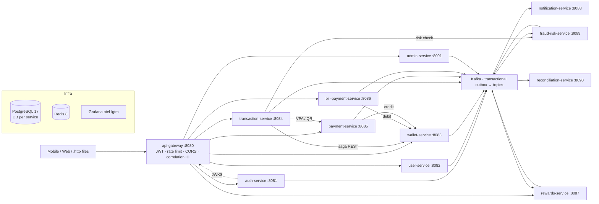

# PayVerse

A PhonePe-style digital wallet and payments platform: Java 21, Spring Boot 4.1 microservices,
PostgreSQL, Redis, Kafka (KRaft) and OpenTelemetry. **No real money moves.** Every external
integration (UPI switch, payment gateway, billers, SMS/e-mail) is a clearly named mock.

> Status: **All 8 phases complete** — 12 services, dashboards, load tests, Helm, CI and `make e2e`. See [CLAUDE.md](CLAUDE.md) for the phase tracker and
> [docs/PHASE-0-PLAN.md](docs/PHASE-0-PLAN.md) for the full architecture, event catalog and DB schemas.

## Architecture



| Module | Purpose | Status |
|---|---|---|
| `libs/common-money` | `Money` value object (BigDecimal, scale 2, HALF_EVEN, INR) | ✅ |
| `libs/common-error` | Error codes, `PayverseException`, RFC 9457 handler | ✅ |
| `libs/common-events` | Event envelope, topic catalog, payload records | ✅ |
| `libs/common-security` | JWT resource server, roles, `AuthenticatedUser` | ✅ |
| `libs/common-web` | Correlation IDs, Idempotency-Key, PII masking, AES-GCM encryption, JSON logs | ✅ |
| `libs/common-outbox` | Transactional outbox relay, idempotent consumers, DLT | ✅ |
| `libs/common-test` | Reusable Testcontainers, test JWTs, ArchUnit rules | ✅ |
| `services/api-gateway` | Spring Cloud Gateway (WebFlux) | ✅ |
| `services/auth-service` | OTP login, RS256 JWT + JWKS, refresh rotation, devices, Argon2 PIN | ✅ |
| `services/user-service` | Profile, KYC tiers (mock), bank accounts, beneficiaries | ✅ |
| `services/wallet-service` | Double-entry ledger, KYC limits, idempotent saga steps, freeze, concurrency-proven | ✅ |
| `services/transaction-service` | P2P by mobile / UPI ID / QR via an orchestrated saga, money requests, split bills, history, CSV/PDF statements | ✅ |
| `services/payment-service` | VPAs, collect requests, static/dynamic QR (ZXing), MOCK UPI switch, MOCK payment gateway | ✅ |
| `services/notification-service` | SMS / e-mail / push via MOCK providers, DB templates, retries → DEAD, inbox, platform dead-letter desk with replay | ✅ |
| `services/rewards-service` | Cashback rules engine (budgets, caps, first-time), scratch cards, coupons, referral bonuses, clawback | ✅ |
| `services/bill-payment-service` | Recharges and bills via MOCK billers (fetch, pay, refund on decline), auto-pay mandates | ✅ |
| `services/fraud-risk-service` | Rule-based risk scoring (velocity, amount anomaly, new device, PIN lock), review flags, ML-ready model port | ✅ |
| `services/reconciliation-service` | Spring Batch recon: PG charges vs ledger, transfers vs UPI switch, ledger integrity; mismatch reports | ✅ |
| `services/admin-service` | Back office: user search, wallet freeze, disputes, maker-checker refunds, audit log, key rotation | ✅ |

## Prerequisites

- macOS on Apple Silicon (any arm64/amd64 machine works), 16 GB RAM
- JDK 21+ (the build targets Java 21; JDK 25 works)
- [OrbStack](https://orbstack.dev) or Docker Desktop
- No local Maven needed (`./mvnw` is included)

## Quick start

```bash
make env                 # .env with random secrets (git-ignored)
make infra-up            # Postgres, Redis, Kafka + topics, Grafana LGTM (~3.5 GB limit)
make verify              # all unit + Testcontainers integration tests
make run-auth-service    # :8081   (each in its own terminal)
make run-user-service    # :8082
make run-wallet-service  # :8083
make run-payment-service # :8085
make run-transaction-service # :8084
make run-bill-payment-service # :8086
make run-rewards-service # :8087
make run-fraud-risk-service # :8089
make run-notification-service # :8088
make run-reconciliation-service # :8090
make run-admin-service # :8091
make smoke               # live two-user scenario through the gateway
make run-api-gateway     # :8080
make otp                 # read the MOCK OTP after requesting one
```

Then open [http/01-auth.http](http/01-auth.http), [http/02-user.http](http/02-user.http) and
[http/03-wallet.http](http/03-wallet.http), [http/04-transactions.http](http/04-transactions.http) and
[http/05-payments.http](http/05-payments.http), [http/06-notifications.http](http/06-notifications.http) and
[http/07-rewards.http](http/07-rewards.http), [http/08-bills.http](http/08-bills.http), [http/09-risk.http](http/09-risk.http), [http/10-recon.http](http/10-recon.http), [http/11-admin.http](http/11-admin.http) in IntelliJ or
VS Code (REST Client) and run the requests with the `local` environment.

> Postgres from Docker is published on **localhost:5433** (`POSTGRES_PORT`), because a native Postgres
> often already owns 5432 on macOS.

| URL | What |
|---|---|
| http://localhost:8080/actuator/health | Gateway health |
| http://localhost:8080/swagger-ui.html | Aggregated Swagger UI (services appear as they are built) |
| http://localhost:3000 | Grafana (admin / admin): Explore → Tempo (traces), Loki (logs), Prometheus (metrics) |

## Observability

Grafana (http://localhost:3000, folder **PayVerse**) gets two provisioned dashboards, generated by
`infra/grafana/build_dashboards.py`:

- **PayVerse — Services**: requests/s, 5xx %, p95 latency, 4xx by code, slowest endpoints, heap, CPU, GC,
  DB pool usage and waiters, Kafka consumer lag, outbox backlog — per service.
- **PayVerse — Payments**: transfers completed/failed/refunded and their value, money added, bills, cashback,
  risk decisions and rules triggered, recon mismatches, notifications (sent/retry/dead), transfer size p50/p95.

Business metrics come from the outbox: every committed domain event increments `payverse_events_total{event_type}`
(and `payverse_events_amount_inr` when it carries an amount), plus `payverse_risk_decisions_total`,
`payverse_notifications_total` and `payverse_outbox_pending`. Traces (Tempo) and logs (Loki) share the correlation ID.

## CI/CD

`.github/workflows/ci.yml`: `mvn verify` (unit + Testcontainers + JaCoCo gate) with a coverage summary,
generated-file checks, Helm lint + kubeconform, and multi-arch (amd64/arm64) images per service pushed to GHCR
from `main`. `.github/workflows/e2e.yml`: nightly and on demand, `make e2e` on a runner.

## Make targets

| Target | Description |
|---|---|
| `make env` | Create `.env` from `.env.example` with generated secrets |
| `make infra-up` / `infra-down` / `infra-reset` | Start / stop / stop and wipe infra |
| `make run-<service>` | Run a service from source, e.g. `make run-api-gateway` |
| `make up-core` | Build jars + run infra and core services in Docker |
| `make build` / `test` / `verify` / `clean` | Maven lifecycle (verify = unit + integration + JaCoCo) |
| `make ps` / `logs` / `topics` | Container status and memory, logs, Kafka topics |
| `make otp` | Latest MOCK OTPs (auth-service log) |
| `make smoke` | Live end-to-end scenario across the running services |
| `make env-upgrade` | Add new settings to an existing `.env` |
| `make testcontainers-reuse` | Enable Testcontainers container reuse |
| `make docker-prune` | Clean dangling images, containers and build cache |
| `make e2e` | Whole stack in Docker + end-to-end scenario (sign up, add money, transfer, pay a bill, verify ledgers) |
| `make e2e-local` | The same scenario against services run from source |
| `make load` | k6 load test (seeds users; `RATE`, `BROWSE_RATE`, `DURATION`) — see [load-tests/](load-tests/README.md) |
| `make helm-lint` / `make k8s-render` | Validate the Helm chart / re-render `deploy/k8s` — see [deploy/](deploy/README.md) |
| `make down` | Stop the service containers (infra keeps running) |

## Memory budget (16 GB laptop)

| Container | Limit |
|---|---|
| postgres | 768 MB |
| redis | 256 MB |
| kafka (KRaft, heap 512 MB) | 1 GB |
| otel-lgtm | 1.5 GB |
| each Spring Boot service (`-Xmx256m`, metaspace ≤ 224 MB, virtual threads; measured 290–480 MB, auth up to ~550 MB under PIN load) | 640 MB |

Use compose profiles (`infra`, `core`, `payments`, `extras`) to start only what you need.

## Conventions

- Money is always `Money` / `BigDecimal`. Never `double`.
- Every write that moves money requires an `Idempotency-Key` header.
- Events are written via the transactional outbox; consumers de-duplicate on `eventId`.
- Errors are RFC 9457 Problem Details with a stable `code` and the request's `correlationId`.
- Layered packages per service (`config`, `controller`, `dto`, `entity`, `repository`, `service`, …), enforced by ArchUnit.
