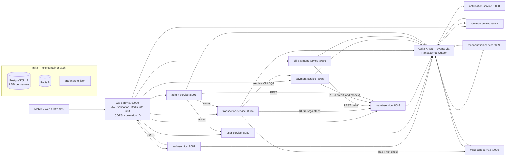
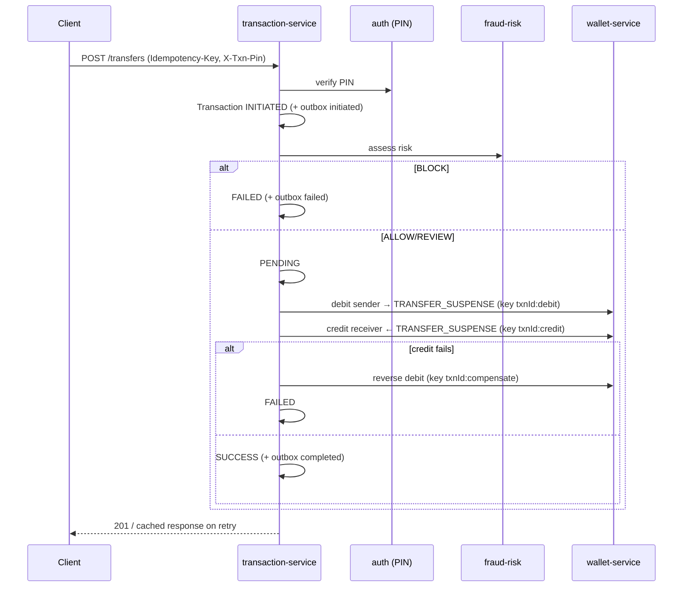

# PayVerse — Phase 0 Architecture & Plan

> Status: **APPROVED 2026-10-13** (defaults accepted: decisions D1–D11, groupId `com.payverse`, `.http` files, KYC limits as listed). Phase 1 implemented — see CLAUDE.md.
> Date: 2026-10-13

## 1. Verified versions & environment

| Item | Version | Source / note |
|---|---|---|
| Spring Boot | **4.1.1** | start.spring.io default (stable) on 2026-10-13 |
| Spring Cloud | **2025.1.3** | start.spring.io BOM range for Boot >=4.0 <4.2 |
| Java language level | **21** (`maven.compiler.release=21`) | Required by the brief; local JDK is 25.0.4, which compiles to release 21 fine |
| Maven | 3.10.0 (local), Maven Wrapper committed | |
| Docker runtime | OrbStack, Docker 29.8.2, arm64 | All images must be multi-arch / arm64 |

Remaining library versions (springdoc, MapStruct, Testcontainers, ZXing, Resilience4j, ArchUnit,
WireMock, Argon2 via Bouncy Castle, OpenPDF) get verified on Maven Central at the start of Phase 1
and pinned in the parent POM.

Spring Boot 4 specifics we'll follow: modular starters (`spring-boot-starter-webmvc`,
`spring-boot-starter-flyway`, etc.), Jackson 3, `spring-boot-starter-opentelemetry`,
JSpecify null-safety annotations.

## 2. Architecture



### Key architectural decisions (please confirm or change)

| # | Decision | Rationale |
|---|---|---|
| D1 | **Synchronous REST for saga steps, Kafka for facts.** transaction-service orchestrates transfers by calling wallet-service (debit/credit/compensate) over REST with Idempotency-Keys and Resilience4j. Everything that *happened* is published as events via the outbox. | Deterministic, easy-to-test saga; no command-topic plumbing. A recovery job re-drives sagas stuck in PENDING. |
| D2 | **Transfer goes through a suspense ledger account.** Step 1 debits sender → `TRANSFER_SUSPENSE`; step 2 credits receiver from suspense; compensation moves suspense → sender. | Gives the saga a real, auditable compensation path (receiver frozen, limit exceeded, timeout). |
| D3 | **Balance = SUM(ledger entries)**, materialised in `wallet.balance` inside the *same* DB transaction as the postings, and cached in Redis (evicted on write). A nightly check (and recon-service) asserts snapshot == SUM(entries). | O(1) reads, ledger remains the source of truth. |
| D4 | **Concurrency:** Redis lock per wallet (`RedisLockRegistry`) around debits + `@Version` optimistic locking as the safety net with bounded retry. Proven by a 100-parallel-transfer Testcontainers test. | As required by the brief. |
| D5 | **Events as JSON with a versioned envelope**, no Schema Registry locally (saves ~500 MB). Event records live in `common-events`; topic names carry `.v1`. | Can switch to Avro/Registry later without changing producers' outbox. |
| D6 | **Outbox relay = polling publisher** inside each service (`@Scheduled`, `SELECT … FOR UPDATE SKIP LOCKED`), not Debezium. | No Kafka Connect container (memory budget). |
| D7 | **Gateway = Spring Cloud Gateway Server WebFlux** (reactive) because the Redis `RequestRateLimiter` lives there; all other services are Spring MVC on virtual threads. | |
| D8 | **Service URLs via properties** (`payverse.clients.wallet.base-url`), resolved through compose DNS or localhost. Spring Cloud LoadBalancer/Eureka can be dropped in later by changing only the client config. | No Eureka/Config Server per brief. |
| D9 | **PII encryption:** AES-256-GCM JPA `AttributeConverter` (key from env var, key-id prefix for rotation) + a blind index (HMAC-SHA256) for lookups on mobile number / account number. Masking via a `@Masked` Jackson serializer and a Logback masking converter. | |
| D10 | **API test collection = `.http` files** (IntelliJ / VS Code REST Client) per service under `http/`. | Zero extra tooling. Say if you prefer Bruno. |
| D11 | **No real money / no real providers.** All external integrations are explicitly named mocks: `MockUpiSwitchAdapter`, `MockPaymentGatewayAdapter`, `MockBillerAdapter`, `MockSmsProvider`, `MockEmailProvider`, `MockPushProvider`, `LogOtpSender`. | |

## 3. Repository layout

```
payverse/
├── pom.xml                          # parent: dependencyManagement, Boot + Cloud BOMs, plugins
├── mvnw, .mvn/
├── Makefile
├── CLAUDE.md                        # decisions, conventions, phase status, run commands
├── README.md                        # Mermaid diagram, setup, links
├── .env.example                     # all secrets/config as env vars (no secrets in code)
├── docker-compose.yml               # profiles: infra, core, payments, extras
├── infra/
│   ├── postgres/init/01-create-databases.sql
│   ├── kafka/create-topics.sh
│   └── grafana/dashboards/          # Phase 8
├── libs/
│   ├── common-money/                # pure Java: Money, Currency, rounding rules
│   ├── common-error/                # ErrorCode, DomainException, ProblemDetail handler
│   ├── common-security/             # resource-server autoconfig, JWT claims, PIN header, roles
│   ├── common-events/               # EventEnvelope, event records, topic constants
│   ├── common-outbox/               # outbox table + relay, processed_events, idempotent consumer
│   ├── common-web/                  # correlation ID filter, idempotency-key support, PII masking, crypto converter
│   └── common-test/                 # Testcontainers (reuse=true) base classes, ArchUnit rules, fixtures
├── services/
│   ├── api-gateway/
│   ├── auth-service/
│   ├── user-service/
│   ├── wallet-service/
│   ├── transaction-service/
│   ├── payment-service/
│   ├── bill-payment-service/
│   ├── rewards-service/
│   ├── notification-service/
│   ├── fraud-risk-service/
│   ├── reconciliation-service/
│   └── admin-service/
├── http/                            # .http request files per service + env file
├── e2e/                             # make e2e script (Phase 8)
├── load-tests/                      # k6 (Phase 8)
├── deploy/k8s/, deploy/helm/        # Phase 8
└── .github/workflows/               # Phase 8
```

> The brief lists four shared modules; I've added `common-outbox`, `common-web` and `common-test`
> because outbox/idempotency/test setup would otherwise be duplicated 10+ times.

### Hexagonal layout inside every service

```
com.payverse.wallet
├── api/                 # REST controllers, request/response DTOs, MapStruct mappers
├── application/         # use cases (command handlers), ports (in/out interfaces), transactions
├── domain/              # entities, value objects, state machines, domain events — NO Spring
└── infrastructure/      # JPA adapters, Kafka, Redis, REST clients, config
```

ArchUnit rules (shared in `common-test`): `domain` depends on nothing but JDK + `common-money`
(+ `common-error` base exception); `api` never touches `infrastructure`; no field injection;
controllers live only in `api`.

> Note: to keep the domain Spring/JPA-free, JPA entities live in `infrastructure.persistence`
> and are mapped to domain objects. More mapping code, but the rule is genuinely enforced.

## 4. Local runtime budget

| Container | Image (arm64) | mem_limit |
|---|---|---|
| postgres | `postgres:17-alpine` | 768m |
| redis | `redis:8-alpine` | 256m |
| kafka | `apache/kafka:4.x` (KRaft, single node) | 1g (`KAFKA_HEAP_OPTS=-Xmx512m`) |
| otel-lgtm | `grafana/otel-lgtm` | 1536m |
| **Infra total** | | **~3.5 GB** |
| each service | `eclipse-temurin:21-jre` (non-root, layered jar) | 512m (`-Xms128m -Xmx256m`, `MALLOC_ARENA_MAX=2`; measured RSS 345–400 MiB) |

Profiles: `infra` (4 infra containers) · `core` (gateway, auth, user, wallet) · `payments`
(transaction, payment, fraud, bill) · `extras` (rewards, notification, recon, admin).
During development you'd normally run infra in Docker and 2–4 services from the IDE / `make run-<svc>`.

Ports: gateway 8080, auth 8081, user 8082, wallet 8083, transaction 8084, payment 8085,
bill 8086, rewards 8087, notification 8088, fraud 8089, recon 8090, admin 8091;
postgres 5432, redis 6379, kafka 9092, Grafana 3000, OTLP 4317/4318.

## 5. Service boundaries & APIs

All under `/api/v1`, JSON, RFC 9457 errors, `X-Correlation-Id` propagated. 🔑 = requires
`Idempotency-Key`; 📌 = requires transaction PIN (`X-Txn-Pin`, verified via auth-service).

### auth-service — identity, credentials, tokens
| Method | Path | Notes |
|---|---|---|
| POST | `/auth/otp/request` | mobile → OTP (Redis, 5 min TTL, logged in dev); 3/10 min/mobile rate limit |
| POST | `/auth/otp/verify` | mobile + OTP + deviceId → access (15 min) + refresh (30 d) JWT; registers user if new |
| POST | `/auth/token/refresh` | rotating refresh tokens, reuse detection revokes family |
| POST | `/auth/logout` | revoke refresh token |
| GET | `/auth/devices` / DELETE `/auth/devices/{id}` | device binding |
| POST | `/auth/pin` | set 4/6-digit PIN (Argon2id) |
| POST | `/auth/pin/change`, `/auth/pin/reset/request`, `/auth/pin/reset/confirm` | reset via OTP |
| POST | `/internal/auth/pin/verify` | service-to-service; 5 failures → 30 min lockout |
| GET | `/.well-known/jwks.json` | public keys (RS256, `kid` rotation-ready) |

### user-service — profile, KYC, bank accounts, contacts
`GET/PUT /users/me` · `POST /users/me/kyc/min` (PAN-style ID → MIN_KYC) ·
`POST /users/me/kyc/full` (multipart doc upload stub → FULL_KYC after mock verification) ·
`GET /users/me/kyc` · `POST/GET/DELETE /users/me/bank-accounts` (encrypted, masked) ·
`POST/GET/DELETE /users/me/beneficiaries` · `GET /internal/users/{id}`, `GET /internal/users/by-mobile/{hash}`

### wallet-service — wallets & double-entry ledger
`GET /wallets/me` (balance, limits, status) · `GET /wallets/me/ledger?page&size&from&to` ·
🔑 `POST /wallets/me/add-money` (initiates via payment-service PG mock) ·
🔑📌 `POST /wallets/me/withdraw` (to linked bank, mock payout) ·
Internal (saga): 🔑 `POST /internal/wallets/{id}/debit`, 🔑 `/credit`, 🔑 `/reverse` ·
Admin: `POST /internal/wallets/{id}/freeze`, `/unfreeze`

KYC limits (configurable): MIN_KYC — max balance ₹10,000, monthly load ₹10,000;
FULL_KYC — max balance ₹2,00,000, P2P ₹1,00,000/day.

### transaction-service — P2P, requests, split, history, statements, saga
🔑📌 `POST /transfers` (to mobile / VPA / QR payload) · `GET /transfers/{id}` ·
`GET /transactions?type&status&from&to&minAmount&maxAmount&page&size&sort` ·
`GET /transactions/statement?from&to&format=pdf|csv` ·
`POST /money-requests` · `GET /money-requests?direction=incoming|outgoing` ·
🔑📌 `POST /money-requests/{id}/pay` · `POST /money-requests/{id}/decline` ·
`POST /split-bills` · `GET /split-bills/{id}` · Internal: 🔑 `POST /internal/transactions/{id}/refund`

### payment-service — simulated UPI & PG
`POST /vpa` · `GET /vpa/me` · `GET /vpa/{vpa}/resolve` ·
`POST /collect-requests` · `POST /collect-requests/{id}/approve` (📌) / `/reject` ·
`POST /qr/static` · `POST /qr/dynamic` (amount, expiry) · `GET /qr/{id}.png` · `POST /qr/decode` ·
🔑 `POST /pg/orders` (add money) · `POST /pg/webhook/mock` (MockPaymentGatewayAdapter callback, HMAC-signed)

### bill-payment-service
`GET /billers?category=MOBILE|ELECTRICITY|DTH|FASTAG|CREDIT_CARD` · `POST /bills/fetch` ·
🔑📌 `POST /bills/pay` · `GET /bills/history` · `POST/GET/DELETE /mandates` (auto-pay, scheduler executes)

### rewards-service
`GET /rewards/scratch-cards` · `POST /rewards/scratch-cards/{id}/scratch` · `GET /rewards/coupons` ·
`POST /rewards/coupons/{code}/redeem` · `GET /rewards/referral` · Admin: `POST/GET /admin/cashback-rules`

### notification-service
Kafka-driven. `GET /notifications/me` (inbox) · Admin: `GET/PUT /admin/templates`

### fraud-risk-service
`POST /internal/risk/assess` → `{score, decision: ALLOW|REVIEW|BLOCK, reasons[]}` ·
Admin: `GET /admin/risk/flags`, `POST /admin/risk/flags/{id}/resolve`, `GET/PUT /admin/risk/rules`.
Rules behind a `RiskRule` interface; a `RiskModel` port reserved for a future ML scorer.

### reconciliation-service
Spring Batch jobs (nightly + on demand): ledger vs payment-provider records, wallet snapshot vs ledger sum.
`POST /admin/recon/jobs/{name}/run` · `GET /admin/recon/runs` · `GET /admin/recon/runs/{id}/mismatches`

### admin-service (roles ADMIN, SUPPORT)
`GET /admin/users?mobile&name&kycTier` · `POST /admin/wallets/{id}/freeze|unfreeze` (ADMIN) ·
`POST/GET /admin/disputes` · `POST /admin/disputes/{id}/resolve` ·
`POST /admin/refunds` (SUPPORT requests) · `POST /admin/refunds/{id}/approve` (ADMIN only, maker-checker) ·
`GET /admin/audit-logs`

Admin users are seeded in auth-service with role claims (no Keycloak).

## 6. Event catalog

Envelope (all topics):
```json
{
  "eventId": "uuid", "eventType": "transaction.completed", "version": 1,
  "occurredAt": "2026-10-13T10:15:30Z", "producer": "transaction-service",
  "aggregateType": "Transaction", "aggregateId": "uuid",
  "correlationId": "uuid", "payload": { }
}
```
Key = aggregateId (ordering per aggregate). Money in payloads = `{"amount":"100.00","currency":"INR"}`.
Every topic has a `<topic>.dlt`. Consumers are idempotent via `processed_events(event_id, consumer)`.

| Topic | Producer | Payload (key fields) | Consumers |
|---|---|---|---|
| `payverse.auth.user-registered.v1` | auth | userId, mobileMasked, referralCode? | user (create profile), wallet (create wallet), payment (default VPA), rewards (referral), notification |
| `payverse.auth.new-device-login.v1` | auth | userId, deviceId, ip | fraud, notification |
| `payverse.auth.pin-locked.v1` | auth | userId, until | notification, fraud |
| `payverse.user.kyc-upgraded.v1` | user | userId, fromTier, toTier | wallet (limits), notification, rewards |
| `payverse.user.bank-account-linked.v1` | user | userId, accountId, maskedNumber, ifsc | notification |
| `payverse.wallet.created.v1` | wallet | walletId, userId, tier | notification |
| `payverse.wallet.money-added.v1` | wallet | walletId, userId, amount, pgReference | rewards, notification, recon |
| `payverse.wallet.money-withdrawn.v1` | wallet | walletId, amount, bankAccountId, payoutRef | notification, recon |
| `payverse.wallet.status-changed.v1` | wallet | walletId, FROZEN/ACTIVE, reason, actor | notification, admin |
| `payverse.wallet.ledger-posted.v1` | wallet | journalId, entries[{account, side, amount}] | recon |
| `payverse.transaction.initiated.v1` | transaction | txnId, type, payer, payee, amount | fraud (velocity stats) |
| `payverse.transaction.completed.v1` | transaction | txnId, type, payerUserId, payeeUserId, amount | rewards, notification, fraud, recon |
| `payverse.transaction.failed.v1` | transaction | txnId, reasonCode | notification |
| `payverse.transaction.reversed.v1` | transaction | txnId, originalTxnId, amount, reason | notification, rewards (claw back), recon |
| `payverse.transaction.money-requested.v1` | transaction | requestId, requester, payer, amount, note | notification |
| `payverse.payment.collect-requested.v1` | payment | collectId, payerVpa, payeeVpa, amount, expiresAt | notification |
| `payverse.payment.pg-charge-settled.v1` | payment | orderId, walletId, amount, providerRef, status | recon |
| `payverse.bill.payment-completed.v1` | bill | billPaymentId, category, biller, amount | rewards, notification |
| `payverse.bill.payment-failed.v1` | bill | billPaymentId, reasonCode | notification |
| `payverse.bill.mandate-executed.v1` | bill | mandateId, billPaymentId, status | notification |
| `payverse.rewards.cashback-granted.v1` | rewards | rewardId, userId, amount, sourceTxnId | wallet (credit from REWARDS_POOL), notification |
| `payverse.fraud.transaction-flagged.v1` | fraud | txnId, userId, score, decision, reasons | admin, notification |
| `payverse.admin.refund-approved.v1` | admin | refundId, txnId, amount, approvedBy | transaction (executes reversal saga) |
| `payverse.recon.mismatch-detected.v1` | recon | runId, type, reference, expected, actual | admin, notification |

## 7. Database schema per service

Common to every service with a DB: `outbox_events(id, aggregate_type, aggregate_id, event_type, payload jsonb, headers jsonb, created_at, published_at, attempts)`,
`processed_events(event_id, consumer, processed_at, PK(event_id, consumer))`,
`idempotency_records(key, scope, request_hash, status, response_code, response_body jsonb, created_at, expires_at)`,
and `audit_log(id, actor, action, entity_type, entity_id, before jsonb, after jsonb, correlation_id, at)` — append-only, enforced by a Postgres trigger that rejects UPDATE/DELETE.
All money columns: `NUMERIC(19,2)` + `currency CHAR(3)`. UUID v7 primary keys.

**auth_db** — `users(id, mobile_enc, mobile_hash UNIQUE, status, roles, created_at)` ·
`devices(id, user_id, device_id, name, bound_at, last_seen_at, trusted)` ·
`refresh_tokens(id, user_id, device_id, token_hash, family_id, expires_at, revoked_at)` ·
`transaction_pins(user_id PK, pin_hash, failed_attempts, locked_until, updated_at)` ·
`signing_keys(kid, public_jwk, private_key_enc, status, created_at)` · (OTPs only in Redis)

**user_db** — `profiles(user_id PK, full_name, email_enc, dob, kyc_tier, version)` ·
`kyc_records(id, user_id, tier, id_type, id_number_enc, id_number_hash, document_ref, status, verified_at)` ·
`bank_accounts(id, user_id, account_number_enc, account_hash, ifsc, holder_name, is_primary, status)` ·
`beneficiaries(id, user_id, type MOBILE|VPA|BANK, value_enc, value_hash, nickname)`

**wallet_db** — `wallets(id, user_id UNIQUE, ledger_account_id, status, kyc_tier, balance, version, created_at)` ·
`ledger_accounts(id, code, type ASSET|LIABILITY|INCOME|EXPENSE, owner_type USER|SYSTEM, owner_id)` (system: `PG_CLEARING`, `BANK_PAYOUT_CLEARING`, `TRANSFER_SUSPENSE`, `REWARDS_POOL`, `BILLER_SETTLEMENT`, `FEES_INCOME`) ·
`journals(id, type, reference_type, reference_id, idempotency_key UNIQUE, created_at)` ·
`ledger_entries(id, journal_id, account_id, side DEBIT|CREDIT, amount CHECK > 0, currency, created_at)` — insert-only; DB constraint trigger ensures each journal's debits = credits ·
`wallet_limit_usage(wallet_id, period, type, used_amount, version)`

**txn_db** — `transactions(id, type P2P|REQUEST_PAY|SPLIT|REFUND|BILL, payer_user_id, payee_user_id, payee_ref, amount, currency, status, failure_code, note, created_at, updated_at, version)` ·
`transaction_status_history(id, txn_id, from_status, to_status, reason, at)` ·
`saga_instances(id, txn_id, current_step, state, compensating, attempts, next_retry_at, payload jsonb)` ·
`money_requests(id, requester_id, payer_id, amount, note, status, expires_at, txn_id)` ·
`split_bills(id, creator_id, total, note)` · `split_bill_shares(id, split_id, user_id, amount, money_request_id, status)`

**payment_db** — `vpas(id, user_id, handle UNIQUE, is_default, status)` ·
`collect_requests(id, payer_vpa, payee_vpa, amount, status, expires_at, txn_id)` ·
`qr_codes(id, user_id, type STATIC|DYNAMIC, vpa, amount, payload, expires_at)` ·
`pg_orders(id, wallet_id, amount, status, provider, provider_ref, created_at)` ·
`upi_switch_records(id, rrn, type, amount, status, provider_ref, created_at)` — the "provider side" data recon compares against

**bill_db** — `billers(id, category, name, adapter_code, fields jsonb)` ·
`bill_payments(id, user_id, biller_id, account_ref, amount, status, biller_ref, wallet_journal_ref)` ·
`mandates(id, user_id, biller_id, account_ref, max_amount, frequency, next_run_at, status)` · `mandate_executions(...)`

**rewards_db** — `cashback_rules(id, name, event_type, conditions jsonb, reward_type, percent, max_amount, budget, active_from, active_to)` ·
`scratch_cards(id, user_id, source_txn_id, amount, status, expires_at)` ·
`coupons(id, code, description, discount jsonb, valid_until, usage_limit)` · `coupon_redemptions` ·
`referrals(id, referrer_id, referee_id, status, reward_id)` · `rewards_ledger(id, user_id, amount, type, source)`

**notification_db** — `templates(id, code, channel SMS|EMAIL|PUSH, locale, subject, body)` ·
`notifications(id, user_id, channel, template_code, rendered, status, attempts, last_error, sent_at)`

**fraud_db** — `risk_rules(id, code, params jsonb, weight, enabled)` ·
`risk_assessments(id, txn_id, user_id, score, decision, reasons jsonb, model_version, at)` ·
`flags(id, assessment_id, status, resolved_by, resolution)` · velocity counters in Redis (sliding window)

**recon_db** — Spring Batch metadata tables · `recon_runs(id, job, started_at, finished_at, status, totals jsonb)` ·
`recon_mismatches(id, run_id, type, reference, ledger_amount, provider_amount, status)`

**admin_db** — `disputes(id, txn_id, user_id, reason, status, assignee, resolution)` ·
`refund_requests(id, txn_id, amount, requested_by, approved_by, status)` · `audit_log` (central admin audit)

## 8. Core flows

### P2P transfer saga (orchestrated by transaction-service)



State machine (domain enum + transition table, illegal transitions throw):
`INITIATED → PENDING | FAILED`, `PENDING → SUCCESS | FAILED`, `SUCCESS → REVERSED`. Terminal: FAILED, REVERSED.

### Idempotency
`Idempotency-Key` (UUID) + user scope + SHA-256 of body. Redis `SETNX` claims the key (in-flight → 409),
the completed response is stored in Redis (24 h) **and** `idempotency_records` (durable). Same key + different body → 422.

## 9. Phase plan

| Phase | Deliverables | Done when |
|---|---|---|
| **1 Foundation** | Parent POM + Maven wrapper; `common-money` (with property-style tests), `common-error`, `common-security`, `common-events`, `common-outbox`, `common-web`, `common-test`; api-gateway (routes, JWT via JWKS, Redis rate limiter, CORS, correlation ID, security headers); docker-compose w/ profiles + mem limits + Postgres init script; Makefile; Dockerfile template; CLAUDE.md; README | `make infra-up` healthy, gateway boots, `mvn verify` green |
| **2 Auth + User** | OTP login, JWT/JWKS, refresh rotation, device binding, Argon2 PIN + lockout, profile, KYC tiers, bank accounts (encrypted), beneficiaries, user-registered event → profile | Sign up → login → set PIN via gateway with `.http` files; integration tests green |
| **3 Wallet** | Wallet auto-creation, double-entry ledger, KYC limits, add-money/withdraw (PG mock stub inside wallet until Phase 4), freeze, idempotency, **100-parallel-transfer concurrency test** | Ledger balanced invariant + concurrency test pass |
| **4 Transaction + Payment** | P2P saga with compensation + recovery job, money requests, split bill, history/filters, PDF/CSV statements, VPA, collect, QR (ZXing), MockUpiSwitchAdapter, MockPaymentGatewayAdapter; WireMock tests | Transfer via mobile/VPA/QR works; failure injection triggers compensation |
| **5 Notification + Rewards** | Kafka consumers, DLT + retry, templates, mock providers; cashback rules engine, scratch cards, coupons, referral | Completed transfer → notification + scratch card; poison message lands in DLT |
| **6 Bill + Fraud** | Billers + mock adapters, bill pay, auto-pay mandates; risk rules (velocity, amount anomaly, new device), flags | Rule-triggered BLOCK stops a transfer |
| **7 Recon + Admin** | Spring Batch recon jobs, mismatch reports; admin search, freeze, disputes, maker-checker refunds, audit logs | Injected mismatch detected; refund approval reverses txn |
| **8 Ops** | Grafana dashboards, k6 tests, K8s manifests + Helm, GitHub Actions (build, test, JaCoCo ≥80% gate, images), `make e2e` | `make e2e` passes end to end |

Each phase ends with: `mvn verify` green → CLAUDE.md updated → small logical commits → summary + run/test steps → wait for "continue".

## 9a. Changes made during implementation

- Phase 2: KYC tier `NONE` added before `MIN_KYC`. Mobile lookup moved to auth-service (`/internal/auth/users/lookup`).
  Client-credentials endpoint `POST /api/v1/auth/oauth/token` added. Docker Postgres on host port 5433.

- 2026-10-14 (user request): services use a **layered** package layout (`config`, `controller`, `dto`, `entity`,
  `repository`, `service`, `security` + optional `exception`, `model`, `mapper`, `messaging`) instead of the hexagonal
  layout in §3. JPA entities carry state rules; `LayeredArchitectureRules` replaces the hexagonal ArchUnit rules.

- Phase 3: tier NONE has zero wallet limits (KYC required to move money). Internal wallet APIs are addressed by
  `userId` (one wallet per user). Freeze blocks debits and new credits; reversals still apply.

- Phase 4: saga state lives on the `transactions` row (`saga_step`, retry fields) instead of a separate
  `saga_instances` table. Transfer idempotency uses `UNIQUE(payer, key)`. payment-service owns PG charges (`/internal/pg/charges`);
  wallet keeps the user-facing add-money API. Webhook-style async PG callbacks are not simulated. `PgChargeSettled.userId`
  replaces `walletId`.

- Phase 5: rewards rule conditions are typed columns instead of `conditions jsonb`; `rewards` is the rewards ledger
  (PENDING_CREDIT → CREDITED, VOIDED, CLAWED_BACK…), plus `user_activity` for first-time rules and `referral_codes`.
  Cashback is credited by rewards-service through the wallet's internal credit API (purpose CASHBACK, D1) and
  `cashback-granted` is published afterwards as a fact — wallet does not consume it. New event
  `rewards.scratch-card-issued`. The platform dead-letter desk (capture + replay of every `.dlt`) lives in
  notification-service.

- Phase 6: risk rule params are typed columns (not `params jsonb`); `user_risk_profiles` and `known_devices` hold
  event-fed signals; velocity is recorded at assessment time (not from `transaction.initiated`). Fail-open for small
  transfers when fraud-risk-service is down. `billers.fields jsonb` became `account_label` + `account_pattern` +
  `fetch_supported`; bill payments are not `transactions` rows (bill-payment-service owns them). Mandate runs are
  recorded in `mandate_executions`.

- Phase 7: refunds are executed over REST (admin-service → transaction-service, idempotent per refund id, D1);
  `admin.refund-approved` is published as a fact rather than consumed as a command. Refunds are full refunds. recon
  totals are columns (not `totals jsonb`) and both sides are staged in `recon_records`; jobs are PG_VS_LEDGER,
  TRANSFERS_VS_UPI and WALLET_INTEGRITY. Users raise disputes at `/api/v1/disputes` (admin-service). Audit queries read
  admin-service's own `audit_log`.

## 10. Questions for you

1. Approve decisions **D1–D11** (especially D1 sync-REST saga, D5 JSON events without Schema Registry, D6 polling outbox)?
2. Base Java package `com.payverse` and Maven groupId `com.payverse` OK?
3. `.http` files, or do you prefer a Bruno collection?
4. KYC limits in §5 — fine as defaults?
