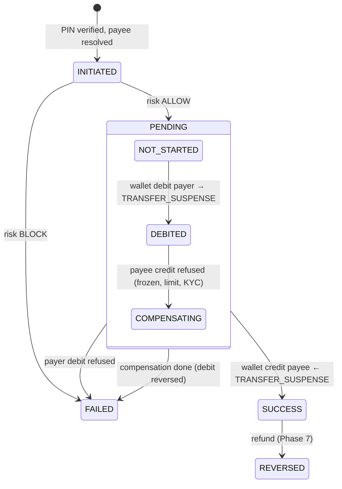

# transaction-service

P2P transfers with an **orchestrated saga**, money requests, split bills, history and statements.
Port **8084**, database `txn_db`.

## Package structure

```
com.payverse.transaction
├── config      TransactionConfig (RestClients, circuit breakers, scheduling), TransactionProperties
├── controller  TransferController, TransactionController, MoneyRequestController, SplitBillController, InternalTransferController
├── dto         request/response records
├── entity      Transaction (+ state machine), TransactionStatusHistory, MoneyRequest, SplitBill + enums (TransactionStatus, SagaStep, …)
├── repository  Spring Data repositories (history via JPA Specifications)
├── service     TransferService, TransferSaga, SagaRecoveryJob, SagaLock, PayeeResolver, MoneyRequestService, SplitBillService,
│               TransactionQueryService, StatementService (CSV/PDF), TransactionEventPublisher,
│               RiskAssessor → RemoteRiskAssessor (fraud-risk-service; PermissiveRiskAssessor MOCK via RISK_ASSESSOR=permissive)
├── client      WalletClient (saga steps), AuthClient (PIN, mobile lookup), PaymentClient (VPA, QR), UserClient (names)
├── mapper      TransactionMapper (MapStruct, viewer-relative views)
└── exception   TransactionErrorCode
```

## The transfer saga



- **State machine:** `TransactionStatus` allows only INITIATED → PENDING | FAILED, PENDING → SUCCESS | FAILED and
  SUCCESS → REVERSED. Every change is written to `transaction_status_history`.
- **Each step** is one wallet-service call with a deterministic Idempotency-Key (`<txnId>:debit`, `:credit`,
  `:compensate`), followed by a committed state update. A crash anywhere leaves a resumable record, and repeating a
  step never moves money twice.
- **Business refusals** (4xx such as `WALLET_INSUFFICIENT_BALANCE`, `WALLET_FROZEN`, `WALLET_LIMIT_EXCEEDED`) fail the
  transfer, or compensate it if the payer was already debited. **Infrastructure failures** (5xx, timeouts, 409/429
  busy) keep it PENDING with exponential back-off (2s … 5 min).
- **`SagaRecoveryJob`** (every 10s) resumes due retries and sagas silent for 60s (crash recovery). `SagaLock` (Redis)
  makes sure only one runner advances a saga at a time.
- **Idempotency** is durable: `UNIQUE(payer_user_id, idempotency_key)` plus a request hash. A retry returns the same
  transaction (HTTP 200, `Idempotent-Replayed: true`); the same key with a different body gives 422.

## Payees

| `payee.type` | Resolved via |
|---|---|
| `MOBILE` | auth-service `/internal/auth/users/lookup` (shown masked) |
| `VPA` | payment-service `/internal/vpa/{vpa}` (MOCK UPI switch: `@payverse` only) |
| `QR` | payment-service `/internal/qr/decode` (dynamic QRs fix the amount: `TXN_QR_AMOUNT_MISMATCH`) |
| `USER` | internal callers only (money requests, collect approvals) |

## Money requests and split bills

- A money request is paid with a normal saga transfer (source `MONEY_REQUEST`). The saga marks it PAID in the same
  transaction as SUCCESS. It expires after 7 days, and can be declined (payer) or cancelled (requester).
- A split bill is equal (`Money.allocate`, which always adds up exactly; leftover paise go first, to the creator) or
  custom. Every participant is resolved first, then the bill and one money request per participant are saved
  atomically.

## API

| Method | Path | Notes |
|---|---|---|
| POST | `/api/v1/transfers` | Idempotency-Key + X-Txn-Pin. 201 SUCCESS/FAILED, 202 PENDING, 200 replay |
| GET | `/api/v1/transfers/{id}` | status |
| GET | `/api/v1/transactions` | `direction`, `status`, `from`, `to`, `minAmount`, `maxAmount`, `page`, `size`, `sort` (createdAt/amount), `order` |
| GET | `/api/v1/transactions/{id}` | details + status history (payer) |
| GET | `/api/v1/transactions/statement?from&to&format=csv\|pdf` | settled transactions, max 1 year |
| POST / GET | `/api/v1/money-requests` | `direction=INCOMING\|OUTGOING` |
| POST | `/api/v1/money-requests/{id}/pay` · `/decline` · `/cancel` | pay needs Idempotency-Key + X-Txn-Pin |
| POST / GET | `/api/v1/split-bills`, `/api/v1/split-bills/{id}` | |
| POST | `/internal/transfers` | SERVICE (collect approvals); PIN still verified |

Payees see only transactions that actually reached them (SUCCESS/REVERSED), without the payer's failure codes.
Statements show counterparties masked; CSV cells are escaped against formula injection.

## Events

**Publishes:** `transaction.initiated`, `transaction.completed`, `transaction.failed`, `transaction.money-requested`.
`transaction.reversed` arrives with refunds in Phase 7.

## Error codes

**Risk check (Phase 6):** before the debit, `RemoteRiskAssessor` sends the transfer (with the payer's
device ID from the access token) to fraud-risk-service. BLOCK → FAILED `TXN_RISK_BLOCKED`; the score and
decision are stored on the transaction (`risk_score`, `risk_decision`). If fraud-risk-service is
unreachable, transfers up to INR 2,000 (`risk-fail-open-max`) are allowed and larger ones blocked.

`TXN_INVALID_AMOUNT`, `TXN_INVALID_PAYEE`, `TXN_PIN_REQUIRED`, `TXN_INVALID_SPLIT`, `TXN_RISK_BLOCKED`, `TXN_NOT_FOUND`,
`TXN_MONEY_REQUEST_NOT_FOUND`, `TXN_SPLIT_NOT_FOUND`, `TXN_ILLEGAL_STATE`, `TXN_MONEY_REQUEST_NOT_PENDING`,
`TXN_SELF_TRANSFER`, `TXN_QR_AMOUNT_MISMATCH`. Errors from auth, wallet and payment services are passed through
unchanged (e.g. `AUTH_PIN_INCORRECT`, `PAYMENT_VPA_NOT_FOUND`).

Requests: [../../http/04-transactions.http](../../http/04-transactions.http).
